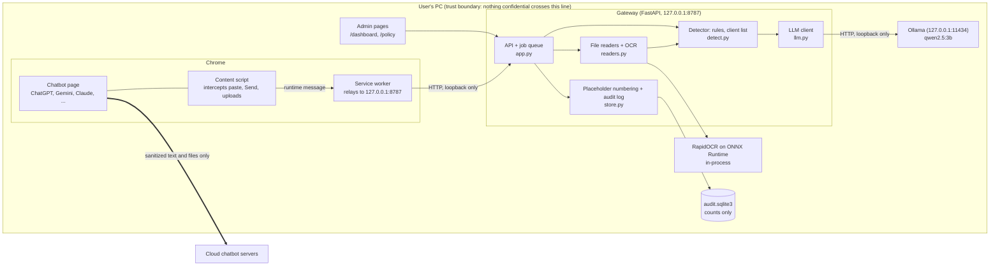
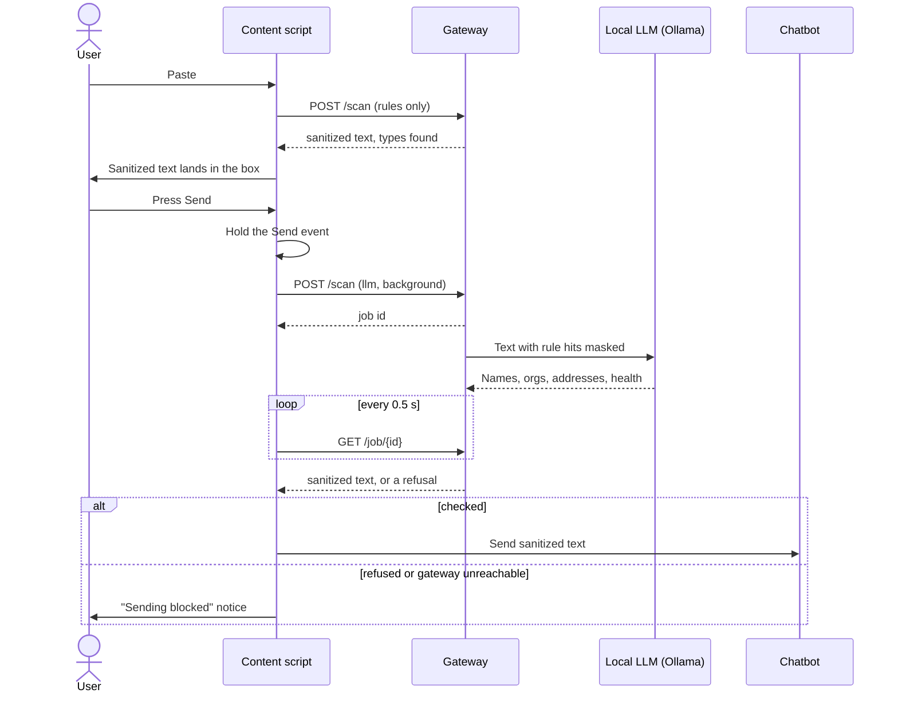
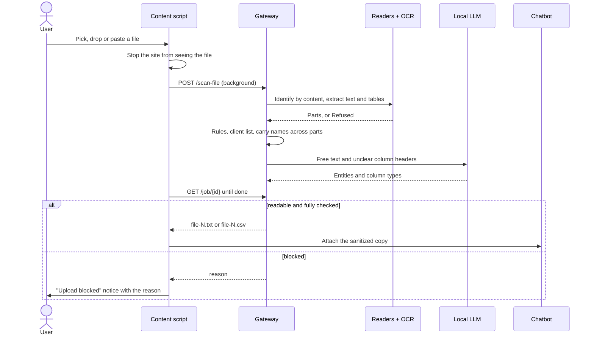
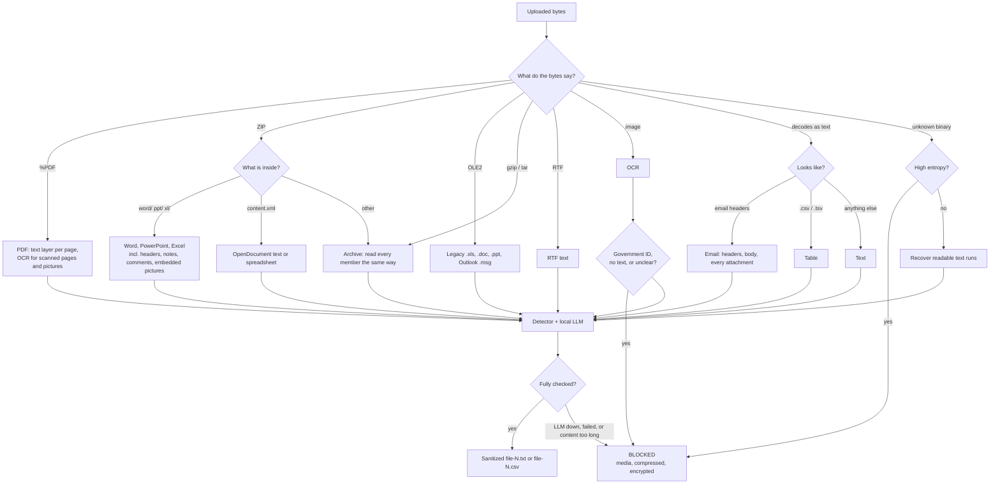
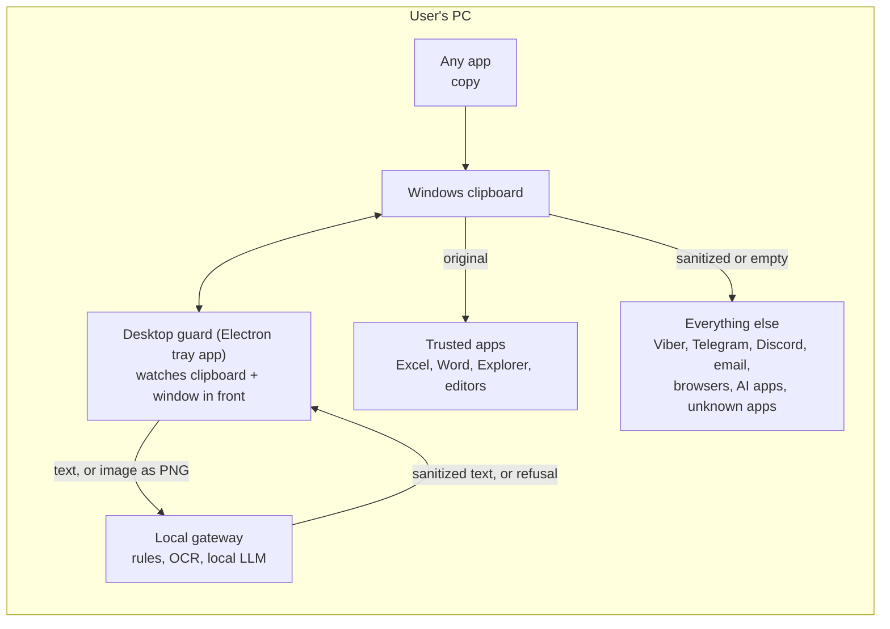
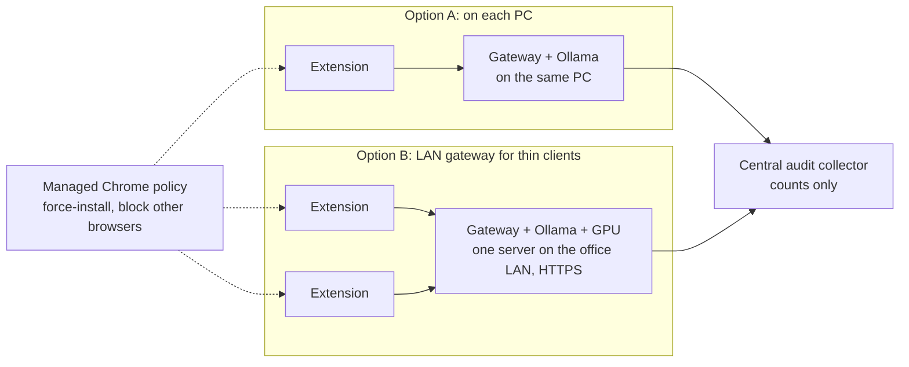

# PromptGuard PH: architecture and infrastructure

PromptGuard PH sits between a person and a cloud chatbot. Everything typed, pasted or uploaded is checked on the
user's own machine first, and only a sanitized copy is allowed to leave. This document describes how the parts fit
together, what runs where, and how it is deployed.

**Current product: the desktop mascot (section 7b) with the browser extension as its sensor (sections 1 and 3).** The
extension draws nothing on the page when the mascot is running; it reports to the gateway, and the mascot shows the
result. The gateway tracks a heartbeat from each browser that has the sensor, so the mascot can warn when one does not.

Sections 1 to 7 describe what is built and running today. Section 8 describes the company-wide deployment, which is
designed but not built.

## 1. System overview



| Component | Where it runs | Technology | Responsibility |
|---|---|---|---|
| Content script | Chatbot tab | Plain JavaScript, Manifest V3 | Intercept paste, Send, file picker and drag-and-drop. Swap in the sanitized copy. Show status. No controls for the user. |
| Service worker | Chrome extension process | Plain JavaScript | The only part allowed to call the gateway. It can reach `127.0.0.1:8787` and nothing else. |
| Gateway | Local process | Python 3.12, FastAPI, Uvicorn | Read, detect, replace, log. Binds to loopback only. |
| File readers | Inside the gateway | PyMuPDF, openpyxl, xlrd, olefile, Pillow, stdlib | Turn any file into text and tables. Decide the format from the bytes, not the name. |
| OCR | Inside the gateway | RapidOCR (PP-OCR models) on ONNX Runtime | Read images, scanned PDF pages and pictures embedded in documents. |
| Detector | Inside the gateway | Regular expressions, client list | Structured identifiers, secrets, labelled fields. |
| Local LLM | Separate local process | Ollama, Qwen2.5 3B | Names, organisations, addresses and health details in free text; spreadsheet column classification. |
| Audit store | Local file | SQLite | Categories and counts per event. Never values. |
| Admin pages | Served by the gateway | HTML, CSS, JavaScript | Audit overview and client list. |

## 2. Trust boundary and data handling

| Data | Where it exists | How long |
|---|---|---|
| Original text and files | Browser tab, then gateway memory | Only while one request is being processed |
| Detected values | Gateway memory during detection | Not kept. Not returned to the extension. Not logged. |
| Placeholder numbering | Gateway memory, per browser session | Salted SHA-256 hashes only, so the same value gets the same placeholder. Lost on restart. Up to 500 sessions. |
| Sanitized text and files | Sent to the chatbot | Out of PromptGuard's control once sent |
| Audit events | `gateway/audit.sqlite3` | Until deleted. Site, source, action, counts by type, file extension, whether the LLM ran. |
| Client list | `gateway/clients.txt` | Until the administrator edits it |

What leaves the device: placeholders such as `[PERSON_1]`, the non-sensitive remainder of the text, and files renamed to
`file-N.txt` or `file-N.csv`. There is no restore function, so the mapping from placeholder to value does not exist
anywhere.

## 3. Request flows

### Typed and pasted text



Text that was already checked while the user paused typing is sent without waiting.

### File upload



## 4. How a file is read



## 5. Detection layers

| Order | Layer | Finds | Typical time |
|---|---|---|---|
| 1 | Rules (`detect.py`) | Secrets and tokens, PH government IDs, cards, bank accounts, emails, phones, IP and MAC addresses, internal hosts, usernames, labelled names, addresses, health, demographic, financial and reference fields, long encoded blobs | Under 1 ms per prompt |
| 2 | Client list | Names the administrator listed | Under 1 ms |
| 3 | Same-upload carry | A name found in a spreadsheet column, replaced in every other part of the upload | Under 1 ms |
| 4 | Local LLM entities | Names without labels, lowercase and Taglish names, organisations, addresses, health details | About 0.9 s median per prompt on CPU |
| 5 | Local LLM column classification | Which spreadsheet columns hold people, organisations, addresses or health data | One call per table |
| 6 | Repeat propagation | Any value caught once is replaced everywhere it appears | Under 1 ms |

Secrets are removed (`[SECRET_REMOVED]`). Everything else becomes a typed, numbered placeholder.

## 6. Fail-closed rules and limits

Nothing is sent when any of these is true:

| Condition | Limit |
|---|---|
| Gateway unreachable | |
| Local LLM not running, or it fails part-way | |
| Text too long to check in full | About 72,000 characters of prose after de-duplication (40 chunks of 1,800) |
| Typed message too long | 200,000 characters |
| File too large | 20 MB |
| Too many images or scanned pages in one upload | 15 |
| Archive or email too big | 100 members, 60 MB unpacked, 3 levels deep |
| Workbook too big | 200,000 rows |
| Image has no readable text, or OCR confidence is low | Mean confidence under 0.7 |
| Image or scanned page looks like a government ID or civil document | |
| File is password-protected, encrypted, compressed in an unknown format, audio or video | |

## 7. Infrastructure as built

Everything runs on one Windows PC. There are no servers, containers or cloud resources.

| Item | Value |
|---|---|
| Hardware tested | Intel Core Ultra 5 235U, 32 GB RAM, no discrete GPU |
| OS | Windows 11 Pro |
| Gateway | `127.0.0.1:8787`, one Uvicorn process, sync handlers on the thread pool, background jobs on threads |
| Local LLM | Ollama on `127.0.0.1:11434`, model `qwen2.5:3b` (about 2 GB on disk), kept loaded for 30 minutes |
| OCR models | Bundled in the `rapidocr-onnxruntime` wheel, loaded on first image |
| Storage | `gateway/audit.sqlite3`, `gateway/clients.txt` |
| Network exposure | Loopback only. No inbound ports open to the network. |
| Internet needed for | The chatbot itself, and one-time downloads (Python packages, the model) |
| Configuration | `PG_MODEL` (model name), `PG_OLLAMA` (Ollama URL) |

### Gateway API

| Method and path | Used by | Purpose |
|---|---|---|
| `GET /health` | Extension, admin pages | Gateway and LLM status |
| `POST /scan` | Extension | Check text. With `background: true` returns a job id. |
| `POST /scan-file` | Extension | Check a file (base64). With `background: true` returns a job id. |
| `GET /job/{id}` | Extension | Poll a background check |
| `POST /decision` | Extension | Record what was redacted (types and counts) |
| `GET /audit` | Admin | Totals, counts by type, recent events |
| `GET`, `PUT /clients` | Admin | Read and replace the client list |
| `GET /dashboard`, `/policy`, `/static/*` | Admin | Admin pages |

Slow checks run as background jobs because Chrome shuts down an extension's service worker when one request stays
open for more than 30 seconds.

### Start-up

`scripts/start-gateway.ps1` checks that Ollama is answering and the model is present, then starts the gateway.

### Repository layout

```
extension/     manifest.json, background.js (relay), adapters.js (site detection), content.js (guard)
gateway/       app.py, detect.py, llm.py, readers.py, files.py, store.py, static/ (admin pages), clients.txt
eval/          dataset.jsonl + run_eval.py (detection), formats_test.py (one sample per file format)
demo/          customers.csv (fictional)
scripts/       start-gateway.ps1
```

## 7b. Desktop guard (Electron)

Every app on the PC is policed. An app receives the original clipboard content only if the administrator trusts it.



| Window in front | Clipboard holds |
|---|---|
| The window the content was copied in | The original |
| A trusted app (`trusted_processes`, `trusted_titles` in `desktop/apps.json`) | The original |
| Any other app | The sanitized text. Empty if the check is still running, failed, or was refused. Copied files: empty. |
| Taskbar, desktop, Alt+Tab, Start, search | No change |

A browser tab counts as its own window (process plus title), so copying in one tab and pasting in another is guarded.

| Item | Value |
|---|---|
| Process | Electron 33 main process, tray icon, small status window |
| Foreground detection | A PowerShell child process calling `GetForegroundWindow` every 100 ms, reporting process name and title on change |
| Clipboard | Polled every 400 ms through Electron's clipboard API |
| Gateway | Reuses a running gateway, or starts one and stops it on exit |
| Images | Sent as PNG to `/scan-file`, replaced by the OCR text, sanitized |
| Copied files | Kept for trusted apps (file list restored through PowerShell), emptied elsewhere |
| Notices | One per copied item, naming types and counts only |
| User controls | None. `npm start` adds a Quit item for development; `npm run guard` has none. |

Not covered: text typed directly into another app, files sent through an app's own file picker or by drag-and-drop,
and a paste made within about 100 ms of switching windows. Intercepting those needs a kernel driver, an input hook or
TLS inspection, which this project does not do.

## 8. Company deployment (designed, not built)

The hackathon build is one PC. The two ways to roll it out are below. None of this section is implemented.



| Concern | Option A: per PC | Option B: LAN gateway |
|---|---|---|
| Where data goes | Never leaves the PC | Leaves the PC, stays on the company LAN |
| Hardware | Each PC needs about 8 GB free RAM for the model | One server with a GPU; PCs need nothing |
| Speed | CPU: about 1 s per prompt, 5 to 15 s per document | GPU: expected to be several times faster (not measured) |
| When it is down | One user is blocked | Everyone is blocked, so it needs a standby |
| Work still needed | Installer, auto-start service, auto-update | TLS, authentication between extension and gateway, concurrency limits |

Needed for either option, and not built:

- **Enforcement.** Force-install the extension through managed Chrome policy (`ExtensionInstallForcelist`) and block
  unmanaged browsers. Without this a user can switch the extension off.
- **Gateway as a service.** Today it is started by hand. It should start with Windows and restart on failure.
- **Central audit.** Each gateway has its own SQLite file. A DPO needs one view across the company.
- **Policy distribution.** The client list is a local text file. It should be pushed from one place.
- **Gateway authentication.** Any local process can call `127.0.0.1:8787` today. That is acceptable on a single-user PC
  and not on a shared server.

## 9. Known gaps in the architecture

- The guard only covers the chatbot sites listed in `extension/manifest.json`, in Chrome. Desktop apps, phones and
  other browsers are outside it.
- Detection is patterns plus a small model. It cannot recognise an unlabelled trade secret written in plain words.
- In spreadsheets, free-text columns are checked by rules only.
- One gateway process handles one LLM request at a time in practice, because the model runs on CPU.
